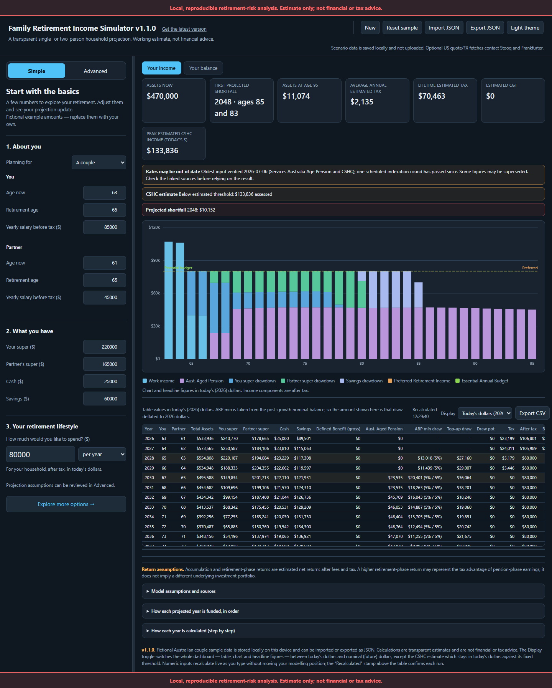

# Retirement Simulator

### [Hosted version](https://dcaddick.github.io/retirement-simulator/)

A free retirement-income planner for Australian couples and singles. It runs entirely in your browser, needs no account, and keeps your numbers on your own device.

## What it helps you work out

- Can we afford to retire at the age we have in mind?
- How long will our super and savings last at the spending we want?
- When might the Age Pension start, and roughly how much would it pay?
- How much tax will we pay along the way?
- What happens to the surviving partner if one of us dies first?
- How far could spending drop in a bad year and still be covered?

## Getting started

Have these ready: each person's age and planned retirement age, super balances, cash and savings, salary if still working, and roughly what you'd like to spend each year. You can enter spending per year, month or week.

Open the simulator and fill in the **Simple** view: **About you**, **What you have** and **Your retirement lifestyle**. It starts with clearly labelled fictional example amounts, so you can see how it works before typing anything personal. The projection updates as you go.

When you want more detail, choose **Advanced**. It adds ownership, planned large expenses, other pensions, shares, returns, inflation and survivor settings. Switching between the views never loses anything you've entered.

*The simulator opens with a simple starting view. Advanced settings are available when you want them. Results are estimates, not financial advice.*

## What it takes into account

- **Work and super:** salaries, retirement ages, employer super guarantee contributions, and super growth until you retire.
- **Drawing down in retirement:** access to super from 60, the minimum yearly pension withdrawals, and the order you choose to draw on super, savings and other money.
- **The Age Pension:** the income and assets tests, deeming, the Work Bonus, and the Commonwealth Seniors Health Card, including couples where only one partner has reached pension age.
- **Tax:** income tax, the Medicare levy and the main senior and low-income offsets, plus capital gains tax when shares are sold.
- **Investments:** cash, savings, shares with dividends and franking credits, and other assets and income.
- **Other pensions:** Australian defined-benefit pensions and the UK State Pension.
- **Big one-off costs:** a new car, renovations or travel, with a clear warning if one can't be fully paid for.
- **Couples and survivors:** an optional "what if one of us dies first" scenario covering inherited super, survivor spending and the switch to single-person tax and pension rules.

## Reading your results

- **Preferred** is the income you'd like to spend in a normal year. The projection always follows it.
- **Essential** is the minimum you could live on in a bad year. The chart draws it as a line so you can see how much room you have, but the projection never invents bad years for you.
- **Projected shortfall** names the first year your money can't cover Preferred spending, if there is one.
- **Today's dollars** shows every year's figures in current spending power, so amounts 20 years out are easy to compare. Switch to **nominal dollars** to see the actual future amounts.
- An **amber warning** means a planned one-off cost can't be fully paid for. It doesn't change the yearly spending result shown separately.
- The year-by-year table shows where each year's money comes from and where it goes. You can export it to a spreadsheet.

Advanced settings also suggest a simple habit: every six or twelve months, look at the next two years of spending and planned costs, and top up savings from super if you want a buffer. That suggestion is guidance only and isn't built into the projection.

## What it won't do

- **It isn't financial advice.** It's an educational estimate built for one household's planning and shared openly. It isn't a regulated calculator.
- **Rules and rates change.** Pension, tax and deeming figures are dated and will go out of date. The simulator tells you when its built-in figures may have been superseded.
- **Super before 60 isn't modelled.** Super access age must be 60 or older.
- **Results aren't predictions.** Returns, inflation, health and policy won't follow any fixed assumption.

The [Deferred Review Register](docs/DEFERRED-REVIEW.md) lists known limitations openly.

## Your data stays with you

- Calculations happen in your browser. Nothing you enter is uploaded, and no account is needed.
- There are no ads, trackers or analytics.
- Scenarios are saved in your browser automatically. That storage is convenient but not encrypted.
- You can export a scenario to a file and import it again later or on another device. Treat that file like a bank statement.
- The hosted version keeps scenarios in that browser's local storage. Scenarios from a downloaded copy do not automatically appear there, and the reverse is also true; move them with JSON export/import.
- If you use the hosted version, GitHub Pages serves the page, so GitHub sees ordinary web-request details such as the visitor IP address. Your scenario is never sent to GitHub.
- The only optional network lookups are US share prices and exchange rates, and the simulator tells you before using them.

Never post a personal scenario in a public issue. Use made-up numbers to report a problem. See [Security and privacy reporting](SECURITY.md).

**[Download the simulator](https://github.com/dcaddick/retirement-simulator/releases/latest/download/retirement-simulator.html)** to keep your own copy. It's a single file that runs offline in your browser.

## Getting a second opinion

No independent review of this simulator has been performed. Nothing here is verified, certified or endorsed.

If you'd like your accountant, tax agent or financial adviser to check the model before you rely on it, the [Independent Review Materials](docs/independent-review/README.md) give them everything they need: the exact release, how each rule is calculated, the official sources behind it, worked example scenarios and the project's own list of known problems.

<!-- Outside Australia? cross-link placeholder: add once agreed with mjcrepeau/retirement-planner (US and Canada). -->

## Inspiration

The income-chart concept and survival-context treatment were inspired by the retirement income graphs in [SuperCalcs Retirement Income Simulator](https://supercalcs.com.au/ris9/mst/graphs). This project is an independent implementation with its own transparent assumptions and calculation model; it is not affiliated with or endorsed by SuperCalcs.

## For developers and reviewers

The [technical overview](docs/TECHNICAL.md) covers running it locally, storage, the full model coverage, network boundaries, testing, the parked Monte Carlo companion and project history. [Model methodology](docs/MODEL-METHODOLOGY.md) sets out the calculation sequence, and the [changelog](CHANGELOG.md) records each release.

Issues, feature requests, forks and pull requests are welcome, though there are no guarantees of support or maintenance. Modelling changes should include dated official sources, explicit assumptions and regression tests. Please read [CONTRIBUTING.md](CONTRIBUTING.md) first.

## Licence

Licensed under the [Apache License 2.0](LICENSE). The software is provided on an "AS IS" basis, without warranties or conditions of any kind.
